# Módem QPSK sobre RFSoC 4x2

Módem QPSK completo implementado en la lógica programable (PL) de una placa **RFSoC 4x2** (AMD Zynq UltraScale+ RFSoC XCZU48DR), con prueba en lazo cerrado DAC → cable SMA → ADC dentro de la misma placa.

El repositorio contiene las dos versiones desarrolladas en el Trabajo Fin de Grado:

| Versión | Enlace analógico | Frecuencia de muestreo | Cables |
|---|---|---|---|
| **Banda base** | I y Q como dos señales reales en banda base | 1 GSPS | 2 (DAC A → ADC, DAC B → ADC) |
| **Portadora de 1 GHz** | I/Q sobre una portadora de 1,000 GHz (mezcladores del RF Data Converter) | 4 GSPS | 1 (DAC A → ADC) |

> Autor: Rubén Mata Alonso · Trabajo Fin de Grado · Universidad autonoma de Madrid, Ingenieria en Tecnologias de la Telecomunicación, Curso 26/27
> Memoria completa: [`docs/`](docs/)

---

## Arquitectura

```mermaid
flowchart LR
    G["PRBS-15 / secuencia fija<br/>(Generador_PRBS, SEQ_core, dibit_mux)"] --> TX["Modulador QPSK<br/>mapeo ±A_SYM + RRC (OSR 4)<br/>qpsk_tx_core"]
    TX --> P["iq_pack<br/>(solo 1 GHz)"]
    P --> DAC["RF-DAC<br/>interpolación + NCO"]
    DAC -- "cable SMA" --> ADC["RF-ADC<br/>NCO + decimación"]
    ADC --> MF["Filtro adaptado RRC<br/>rrc_mf (I y Q)"]
    MF --> GA["Sincronismo de símbolo<br/>Gardner (simple_gardner)"]
    GA --> RX["Lazo de Costas + decisión<br/>qpsk_rx_core"]
    RX --> BER["Medidor de BER PRBS-15<br/>ber_checker_axi_lite"]
```



Todo el procesado digital corre en la PL a **250 MHz**. El Zynq (PS) solo configura y lee resultados desde PYNQ por AXI-Lite.

## Estructura del repositorio

```text
rtl/
├── common/                 RTL compartido por las dos versiones
│   ├── tx/                 qpsk_tx_core.sv, simple_tx_axis.v, rrc_fir.sv
│   ├── rx/                 rrc_mf.sv, rrc_mf_top.v, gardner_ted.sv, simple_gardner.v,
│   │                       qpsk_rx_core.sv, simple_rx_axis.v, nco_lut_pkg.sv
│   ├── generadores/        Generador_PRBS.v, SEQ_core.v, dibit_mux.v
│   └── ber/                prbs_ber_check.sv, prbs_ber_check_auto.sv, ber_checker_axi_lite.v
├── baseband/               qpsk_coef_pkg.sv  (A_SYM = 4000)
└── carrier_1ghz/           qpsk_coef_pkg.sv  (A_SYM = 10000), iq_pack.v
sim/                        testbenches (XSim)
vivado/
├── constraints/            mts.xdc
├── baseband/               mts_bd.tcl, mts.bd
└── carrier_1ghz/           mts_bd.tcl, mts.bd
model/                      modelo de referencia en Python (algoritmo, coeficientes, Costas)
pynq/                       notebooks de prueba en placa
matlab/                     análisis de capturas ILA
docs/                       memoria y guía de la portadora de 1 GHz
```

Los bitstreams (`mts.bit` + `mts.hwh`) de cada versión están en **Releases** (`v1.0-banda-base` y `v2.0-portadora-1ghz`).

### Módulos

| Fichero | Función |
|---|---|
| `Generador_PRBS.v` | Generador PRBS-15 de 2 bits por símbolo. **Declara el módulo `PRBS_core`.** Avanza solo con `en` (= `tx_sym_load`). |
| `SEQ_core.v` | Secuencia fija de 32 símbolos para depuración, al mismo ritmo de símbolo. |
| `dibit_mux.v` | Selecciona PRBS o secuencia fija (GPIO). |
| `qpsk_tx_core.sv` / `simple_tx_axis.v` | Mapeo a ±A_SYM, inserción de ceros ×4 y conformado RRC en I y Q. Envoltorio Verilog para IP Integrator. |
| `rrc_fir.sv` | FIR RRC en forma transpuesta (cascada de DSP). |
| `iq_pack.v` | Solo 1 GHz. Empaqueta I y Q en `{Q[31:16], I[15:0]}` para el DAC en modo I/Q→Real. |
| `rrc_mf.sv` / `rrc_mf_top.v` | Filtro adaptado RRC de 65 coeficientes, 4 carriles, árbol de sumadores segmentado. |
| `gardner_ted.sv` / `simple_gardner.v` | Detector de Gardner y lazo de sincronismo; entrega 1 muestra por símbolo. `loop_inv` controlable por GPIO. |
| `qpsk_rx_core.sv` / `simple_rx_axis.v` | Derrotación con tabla de senos, lazo de Costas y decisión `{signo(Q), signo(I)}`. |
| `prbs_ber_check.sv` | Comprobador PRBS-15 autosincronizante con integrador de errores con fuga. |
| `prbs_ber_check_auto.sv` | Cuatro comprobadores (0°, 90°, 180°, 270°); se queda con el que engancha. |
| `ber_checker_axi_lite.v` | Envoltorio AXI-Lite del medidor de BER. |
| `qpsk_coef_pkg.sv` | Parámetros y coeficientes RRC, generados con `model/qpsk_model.py`. `A_SYM` se ajustó después a mano (4000 y 10000). |

### Modelo de referencia en Python (`model/`)

Scripts en Python puro, usados para validar los algoritmos antes de pasarlos a RTL.

| Fichero | Función |
|---|---|
| `qpsk_model.py` | Modelo de referencia del módem en banda base: mapeo, RRC, filtro adaptado y decisión. Genera los coeficientes RRC cuantizados que usa el RTL. |
| `qpsk_costas_fixed.py` | Lazo de Costas en punto fijo, réplica del RTL (acumulador de 32 bits, tabla de senos, `KP`/`KI` enteros). |
| `qpsk_sync_model.py` | Recuperación de portadora con desfase, deriva de frecuencia, ruido AWGN y retardo fraccionario. |
| `qpsk_passband_model.py` | QPSK en banda pasante sobre un solo canal real (subida y bajada con NCO). |
| `plot_constelacion.py`, `plot_from_csv.py`, `ver_constelacion_ila.py` | Dibujan constelaciones en SVG a partir del modelo, de la simulación o de un CSV exportado del ILA. |

---

## Reconstruir el proyecto en Vivado

Probado con **Vivado 2024.1**, part `xczu48dr-ffvg1517-2-e`.

1. Crea un proyecto RTL vacío para ese part.
2. Añade como fuentes de diseño todo `rtl/common/` y la carpeta de la versión que quieras (`rtl/baseband/` o `rtl/carrier_1ghz/`). Los módulos tienen que estar en el proyecto antes del paso 4, porque el block design los usa como *module references*.
3. Añade `vivado/constraints/mts.xdc` como restricciones.
4. En la Tcl Console: `source vivado/<versión>/mts_bd.tcl`. Crea el block design `mts`.
5. Sources → clic derecho en `mts.bd` → **Create HDL Wrapper** y fíjalo como top.
6. **Generate Bitstream**. El `.bit` queda en `<proyecto>.runs/impl_1/mts_wrapper.bit` y el `.hwh` en `<proyecto>.gen/sources_1/bd/mts/hw_handoff/mts.hwh`. Cópialos juntos con el mismo nombre base (`mts.bit` / `mts.hwh`).

### Simulación

Los testbenches de `sim/` se ejecutan en XSim añadiendo `rtl/common/` y el `qpsk_coef_pkg.sv` de una de las dos versiones.

| Testbench | Qué comprueba |
|---|---|
| `tb_tx_core.sv`, `tx_tesbench.sv` | Modulador: mapeo, sobremuestreo y conformado RRC |
| `tb_rrc_mf.sv` | Filtro adaptado RRC |
| `tb_gardner.sv` | Convergencia del lazo de Gardner desde una fase descolocada |
| `tb_prbs_ber.sv` | Comprobador PRBS-15 con rotaciones de fase |
| `tb_prbs_direct.sv` | Generador PRBS conectado directamente al medidor de BER con autorrotación |

---

### Secuencia

1. Copia a la placa `mts.bit` y `mts.hwh` de la versión (desde Releases).
2. Programa los relojes a 500 MHz: `xrfclk.set_ref_clks(lmk_freq=500.0, lmx_freq=500.0)`.
3. Carga el overlay y sincroniza los tiles (MTS), como en el notebook de `pynq/`.
4. Elige los datos de prueba y lee el BER:

## Resultados

- **Banda base:** la cadena completa decodifica la secuencia fija al 100 % en las cinco etapas analizadas con ILA (generador, TX, ADC, filtro adaptado y símbolo decidido), y el receptor recupera el PRBS-15 transmitido.
- **Portadora de 1 GHz:** enlace funcionando con la portadora a 1,000 GHz, constelación sin espejo con el NCO del ADC a −1 GHz y **BER = 0** medido con el `ber_checker` en placa. <!-- Opcional: añade aquí el número de bits de tu medida -->

La memoria del TFG (en `docs/`) detalla el diseño, la depuración y las medidas.

---

## Créditos

- El fichero `vivado/constraints/mts.xdc` y la base del block design derivan de [Xilinx/RFSoC-MTS](https://github.com/Xilinx/RFSoC-MTS), © 2023 Advanced Micro Devices.

